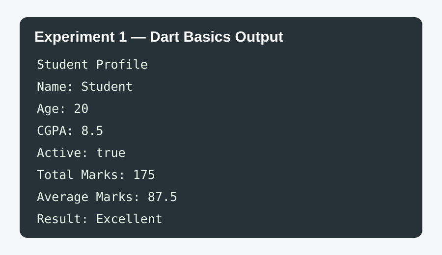
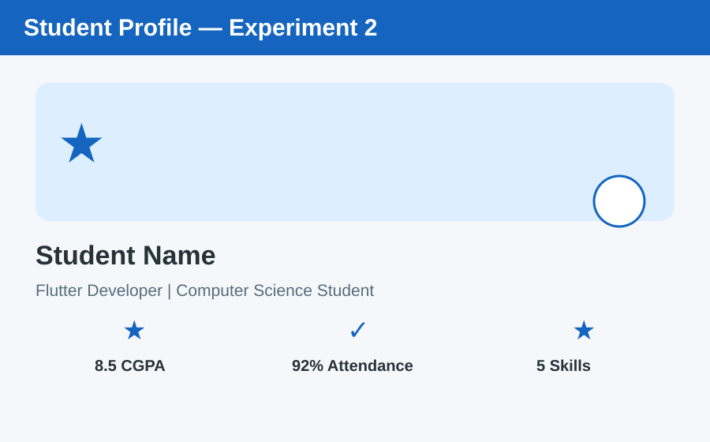
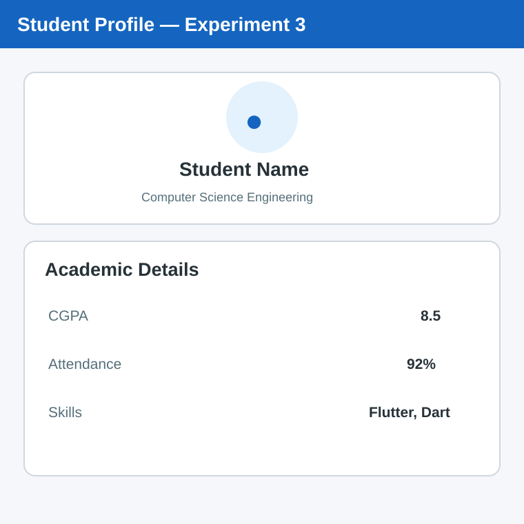
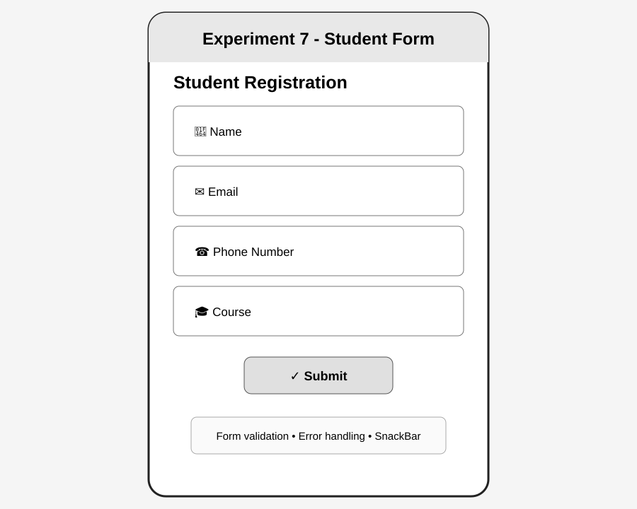
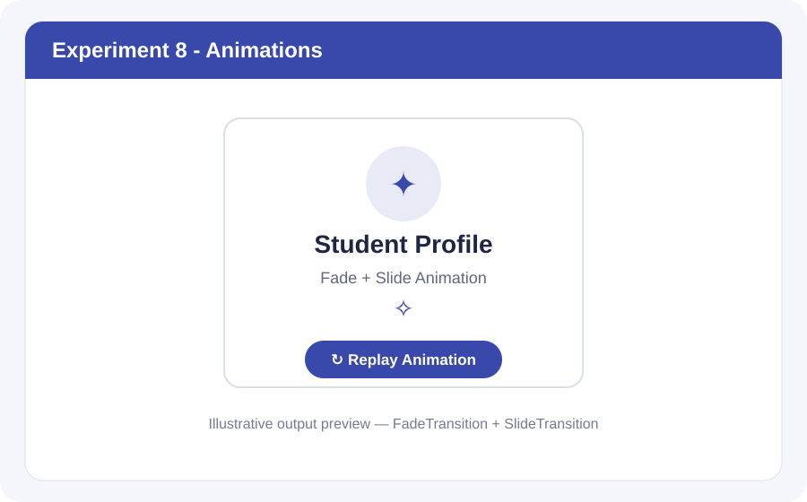
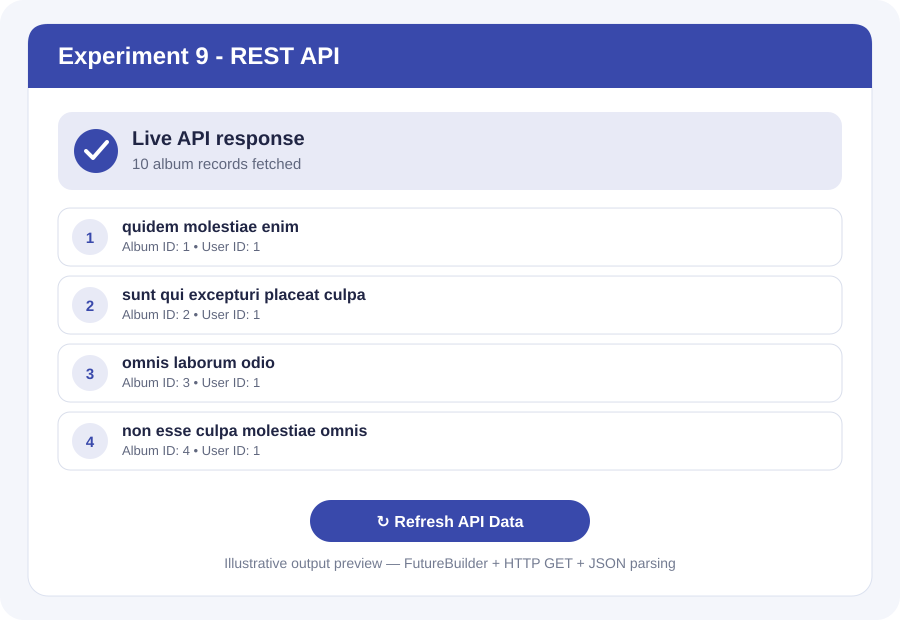
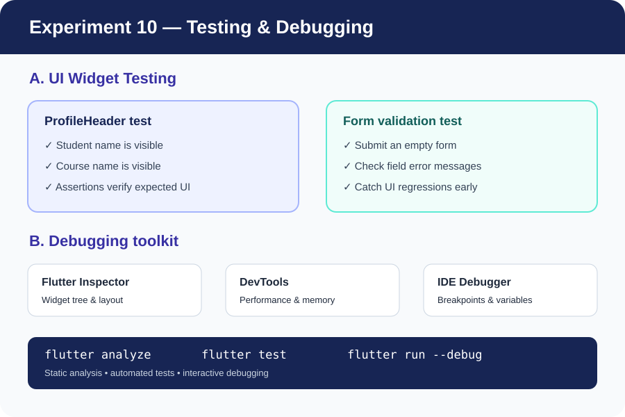

# Student Profile App — Flutter Web

A responsive student profile portal built with Flutter. The project combines a student-facing dashboard, an admin view for student records, and a learning lab containing ten Flutter experiments.

<p align="center">
  <a href="https://asish358.github.io/Flutter_project/">
    <strong>🌐 Open the live website</strong>
  </a>
  &nbsp; · &nbsp;
  <a href="https://github.com/asish358/Flutter_project/actions">
    <strong>⚙️ View GitHub Actions</strong>
  </a>
</p>

## Website overview

The deployed Flutter Web app provides a student portal and an admin dashboard. The student area brings profile and academic information together, while the admin area lets an administrator open individual student profiles. The interface is responsive and adapts to desktop and smaller screens.

**Live site:** https://asish358.github.io/Flutter_project/

> The experiment images below are repository-maintained visual output previews, matched to the corresponding experiment source files. They are not claimed to be live browser captures.

## Experiments 1–10 — outputs matched to source

Each preview is linked to the matching Dart experiment. Open the source file to inspect the implementation.

### Experiment 1 — Dart language basics

**Source:** [`experiments/01_dart_basics.dart`](experiments/01_dart_basics.dart)

Covers variables, data types, string interpolation, arithmetic operations, and an `if/else` decision using sample student details.

<p align="center">
  
</p>

### Experiment 2 — Flutter widgets and layouts

**Source:** [`experiments/02_widgets_layouts.dart`](experiments/02_widgets_layouts.dart)

Builds a student profile layout using `Column`, `Row`, and `Stack`, including a profile banner, student information, and summary metrics.

<p align="center">
  
</p>

### Experiment 3 — Responsive user interface

**Source:** [`experiments/03_responsive_ui.dart`](experiments/03_responsive_ui.dart)

Uses `MediaQuery` and width breakpoints to adapt the profile layout for mobile, tablet, and desktop screens.

<p align="center">
  
</p>

### Experiment 4 — Navigation with named routes

**Source:** [`experiments/04_navigation_named_routes.dart`](experiments/04_navigation_named_routes.dart)

Defines named routes for the profile, details, and skills screens, then navigates between them using Flutter's Navigator.

<p align="center">
  
</p>

### Experiment 5 — Stateful widgets and Provider state management

**Sources:** [`experiments/05_setstate_counter.dart`](experiments/05_setstate_counter.dart) · [`experiments/05_state_management.dart`](experiments/05_state_management.dart) · [`experiments/counter_provider.dart`](experiments/counter_provider.dart)

Demonstrates changing UI state with `StatefulWidget` and `setState()`, plus Provider's `ChangeNotifier` and `notifyListeners()` for a counter with increase, decrease, and reset actions.

<p align="center">
  
</p>

### Experiment 6 — Reusable custom widgets and themes

**Source:** [`experiments/06_custom_widgets_themes.dart`](experiments/06_custom_widgets_themes.dart)

Creates reusable profile components, including a profile header and information cards, and styles them with `ThemeData` and custom text/card styles.

<p align="center">
  
</p>

### Experiment 7 — Forms, validation, and error handling

**Source:** [`experiments/07_forms_validation.dart`](experiments/07_forms_validation.dart)

Builds a student registration form with name, email, phone number, and course fields. Uses `Form`, `GlobalKey<FormState>`, `TextFormField`, field validators, and submission feedback.

<p align="center">
  
</p>

### Experiment 8 — Flutter animations

**Source:** [`experiments/08_animations.dart`](experiments/08_animations.dart)

Uses an `AnimationController`, `FadeTransition`, and `SlideTransition` to animate a student profile card. The replay action starts the animation again.

<p align="center">
  
</p>

### Experiment 9 — REST API integration

**Source:** [`experiments/09_rest_api.dart`](experiments/09_rest_api.dart)

Sends an HTTP GET request to JSONPlaceholder, parses album records into Dart objects, and displays them with `FutureBuilder`, loading/error handling, and refresh support.

<p align="center">
  
</p>

**Dependency:** The project uses the `http` package. Install dependencies with `flutter pub get`.

### Experiment 10 — Widget testing and debugging

**Source:** [`experiments/10_testing_debugging.dart`](experiments/10_testing_debugging.dart)  
**Tests:** [`test/exp10_testing_debugging_test.dart`](test/exp10_testing_debugging_test.dart)

Presents Flutter testing and debugging tools, including widget assertions, form validation checks, Flutter Inspector, DevTools, breakpoints, and terminal verification commands.

<p align="center">
  
</p>

## Experiment source directory

```text
experiments/
├── 01_dart_basics.dart
├── 02_widgets_layouts.dart
├── 03_responsive_ui.dart
├── 04_navigation_named_routes.dart
├── 05_setstate_counter.dart
├── 05_state_management.dart
├── 06_custom_widgets_themes.dart
├── 07_forms_validation.dart
├── 08_animations.dart
├── 09_rest_api.dart
├── 10_testing_debugging.dart
└── counter_provider.dart
```

## Run the website locally

### Requirements

- Flutter SDK (stable channel)
- Chrome (for Flutter Web)
- VS Code or another editor (optional)

### Setup and launch

```bash
flutter doctor
flutter pub get
flutter config --enable-web
flutter devices
flutter run -d chrome
```

### Build for web

```bash
flutter build web --release
```

The production bundle is generated in `build/web/`.

## Automated checks

Run the same core checks used by the verification workflow:

```bash
flutter pub get
flutter analyze
flutter test
```

The widget tests cover the login/student dashboard flow and Experiment 10 UI behavior, including the profile header, student-form validation, and testing/debugging screen. GitHub Actions runs dependency installation, static analysis, and widget tests when changes are pushed to the main branch.

- [Flutter verification workflow](https://github.com/asish358/Flutter_project/actions/workflows/flutter-verification.yml)
- [GitHub Pages deployment workflow](https://github.com/asish358/Flutter_project/actions/workflows/deploy-flutter-web.yml)

## Project structure

```text
lib/
└── main.dart                 # Main Flutter Web app

experiments/                  # Individual experiment programs
outputs/                      # Experiment-matched visual output previews
test/                         # Automated widget tests
web/                          # Flutter Web entry point and assets
.github/workflows/            # Verification and deployment workflows
README.md
```

## Personalisation

Before publishing, review the sample student details and replace them with the information you intend to make public. Update contact links and project URLs in the relevant widgets in `lib/main.dart`.
